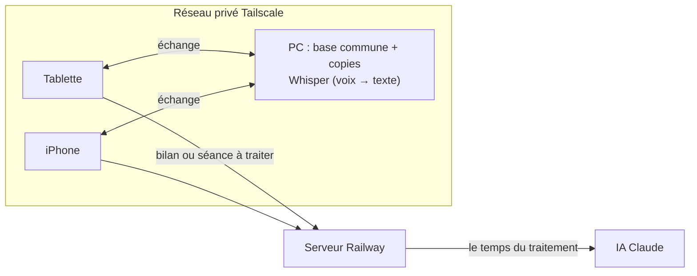
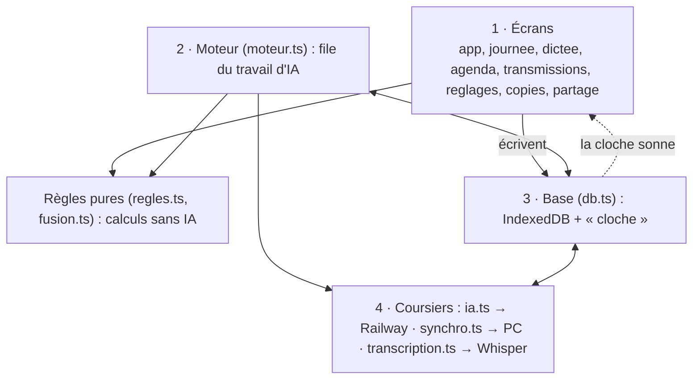

# Muninn — la mémoire du cabinet

Appli de suivi des patients d'un cabinet de kinésithérapie : bilans (PDF ou photos) résumés par l'IA, séances dictées à la voix et mises au propre, rendez-vous, « Ma journée », agenda, transmissions pour un remplaçant.

- Appli web installable (PWA), **Vite + TypeScript sans framework**.
- Les dossiers des patients restent **dans chaque appareil** (IndexedDB) : tablette, iPhone, PC. Chaque appareil marche seul, même sans réseau.
- Le **PC du cabinet** garde la base commune et relie les appareils par **Tailscale** (réseau privé). Il fait aussi tourner **Whisper**, qui transcrit la voix sans qu'elle sorte de chez le kiné.
- Le serveur **Railway** livre l'appli et relaie l'IA (Claude, par l'abonnement du kiné). **Il ne garde jamais aucune donnée patient.**

À lire aussi : `CLAUDE.md` (contexte, règles de travail, choix techniques), `REPRISE.md` (état du projet et historique des versions), `AUDIT.md` (audit de fond du 3 novembre 2026 et plan de nettoyage).

## Architecture

### Les appareils



### Dans chaque appareil : quatre étages



**La règle d'or : tout passe par la base.** Les écrans ne se parlent pas entre eux. Une action (enregistrer une séance, poser un rendez-vous) écrit dans la base, qui « sonne une cloche » (`db.abonner`). Ceux qui l'écoutent font chacun leur travail :

| Qui écoute | Ce qu'il fait | Écrit-il dans la base en retour ? |
|---|---|---|
| `app.ts`, `agenda.ts` | redessinent l'écran | non |
| `synchro.ts` | envoie au PC 2 s plus tard | seulement ce qu'il reçoit du PC, en se signalant (`applique`) pour ne pas se relancer lui-même |
| `moteur.ts` | est lancé par une action (séance enregistrée, bilan ajouté), pas par la cloche | oui, le résultat de l'IA : la cloche sonne, l'écran se redessine, le partage l'envoie |

Il n'y a donc **pas de boucle** : rien de ce qui écoute la cloche ne la fait sonner de nouveau sans fin.

### Dépendances entre modules

Les flèches vont toujours dans le même sens : du démarrage vers les écrans, des écrans vers le moteur et la base, et tout le monde vers les règles pures. **Aucune dépendance circulaire.** C'est vérifié à chaque `npm test` par `tests/unite/architecture.test.ts`, qui échoue si une boucle apparaît, si une règle pure se met à dépendre d'un autre module, ou si un module autre que `main.ts` dépend de `app.ts`.

| Module | Rôle | Dépend de |
|---|---|---|
| `main.ts` | démarrage : ouvre la base, branche le partage, propose les mises à jour | app, copies, db, mascotte, moteur, partage, reglages, reglages-ia, synchro, ui, verifications |
| `app.ts` | liste des patients, fiche (bilans, séances, rendez-vous, homonymes), visionneuse | agenda, db, dictee, journee, moteur, pdf, prochain-rdv, regles, seances-manquantes, ui, voix-seance |
| `journee.ts` | « Ma journée » | db, regles, ui |
| `agenda.ts` | agenda de la semaine en demi-journées | db, regles, transmissions, ui |
| `transmissions.ts`, `transmissions-pdf.ts` | transmissions pour un remplaçant et leur PDF (sans IA) | db, regles, ui |
| `dictee.ts` | dictée groupée, rangée patient par patient | db, ia, moteur, prochain-rdv, regles, seances-manquantes, transcription, ui |
| `voix-seance.ts` | « Enregistrer ma séance » sur la fiche | ia, transcription, ui |
| `copies.ts`, `fichier-copie.ts` | copies de sécurité internes et fichier chiffré hors de Chrome | db, regles, ui, verifications |
| `partage.ts` | écran du partage avec le PC | synchro, transcription, ui |
| `reglages.ts`, `palettes.ts`, `saisons.ts`, `mascotte.ts` | affichage, couleurs, décorations, corbeau | — |
| `reglages-ia.ts` | réglages de l'IA (abonnement, clé de secours) | db, ia, moteur, ui |
| `seances-manquantes.ts` | jour de rendez-vous passé sans séance (fiche et récapitulatif de la dictée) : retrouver le patient dans la dictée gardée, ou noter l'absence | db, ia, moteur, regles, ui |
| `prochain-rdv.ts` | question « Prochain rendez-vous ? » (date + matin / après-midi, ou fin de traitement), sur la fiche et après la dictée groupée | db, regles, ui |
| `moteur.ts` | file d'attente de l'IA : résumés de bilans, mises au propre, rangement des dictées | db, ia, pdf, regles |
| `ia.ts` | consignes données à l'IA, garde-fous, appels | regles |
| `synchro.ts`, `fusion.ts` | échanges avec le PC ; fusion de deux changements faits sur deux appareils | db, fusion, regles |
| `transcription.ts` | voix : Whisper du PC d'abord (en direct, par morceaux coupés aux pauses), Railway en secours | db, ia, regles, synchro |
| `db.ts` | la base IndexedDB `mes-patients` (version 4) et sa cloche | regles |
| `regles.ts` | règles du cabinet, pures et testées : noms, classement, « À venir », homonymes, demi-journées | — |
| `ui.ts`, `pdf.ts`, `verifications.ts` | messages et confirmations, lecteur PDF, vérifications de l'appareil | — |

### Hors de l'appli

| Fichier | Où il tourne | Rôle |
|---|---|---|
| `server.mjs` | Railway | livre `dist/`, relaie l'IA (`/api/ia/*`, code d'accès exigé) ; aucune donnée gardée |
| `serveur/claude.mjs` | Railway | lance Claude Code verrouillé (sans outils, sans mémoire), une demande à la fois |
| `serveur/transcription.mjs` | Railway | transcription de secours (inactive tant que `WHISPER_URL` n'est pas réglé) |
| `public/pc/muninn-pc.mjs` | PC | base commune (`donnees.json`, `fichiers/`, `copies/` sur 60 jours), un seul fichier sans dépendance, joignable seulement par Tailscale avec le code du PC |
| `public/pc/voix.py` | PC | Whisper (faster-whisper), n'écoute que le PC lui-même |
| `public/pc/installer.ps1` | PC | installation et mise à jour en une ligne, sans toucher aux données |

## Commandes

```sh
npm ci              # dépendances
npm run dev         # développement
npm test            # règles, base, partage avec le vrai programme du PC, architecture (Vitest)
npm run test:e2e    # écrans en largeur tablette (Playwright, construit l'appli d'abord)
npm run build       # vérifie les types puis construit dist/
```

Tests : `src/*.test.ts` (règles, base, IA, copies…), `tests/unite/` (partage entre appareils simulés, démarrage du PC, architecture), `tests/e2e/` (écrans ; l'IA, Claude Code et Whisper y sont simulés : aucune vraie requête). Un défaut connu pas encore corrigé est écrit comme un test `it.fails` qui décrit le bon comportement.

## Mise en production

- Travail sur une branche à part ; `npm test` et `npm run test:e2e` au vert avant chaque envoi.
- La production est la branche `claude/patient-management-planning-xg8y6k`, déployée par Railway à chaque envoi, et seulement avec l'accord explicite du kiné (« mets en production »).
- Les appareils proposent la nouvelle version par un bandeau « Mettre à jour » : jamais de rechargement automatique, pour ne pas perdre une dictée en cours.

## Confidentialité

Prénom et initiale du nom seulement, âge sans date de naissance, médecin désigné par sa spécialité. Données de santé pseudonymisées, gardées dans les appareils et sur le PC du kiné ; rien n'est stocké sur Railway (non certifié HDS). La voix ne quitte pas le réseau privé. Seul le texte à traiter part chez Anthropic, le temps du traitement.
